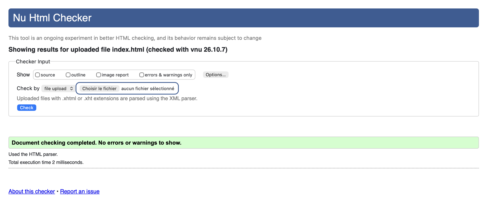

# Brief : To do list 

Cadre : Formation DWWM.
Le but est de créer une page "To-do List". 

Ce répertoire contient : 

1 Branche "main" (basée pour le moment sur la branche lvl1): 
- readme.md : le readme présente le contexte et les fichiers contenus au sein du répertoire/branche.
- index.html : le fichier html contenant le squelette de la page. 
- todolist.js : le fichier javascript contenant les fonctionnalités du bouton et l'apparition progressive de la liste des tâches ajoutées en input. 

1 Branche "lvl1" : 
- readme.md : le readme présente le contexte et les fichiers contenus au sein du répertoire/branche.
- index.html : le fichier html contenant le squelette de la page. 
- todolist.js : le fichier javascript contenant les fonctionnalités du bouton et l'apparition progressive de la liste des tâches ajoutées en input. 
- style.css : le fichier contenant l'esthétique de la page (pour le fun). 
- (optionnel) consigne.md : contenant les consignes pour le brief lvl1.

1 Branche "lvl2" : 
- readme.md : le readme présente le contexte et les fichiers contenus au sein du répertoire/branche.
- index.html : le fichier html contenant le squelette de la page issu du formateur. 
- todolist.js : le fichier javascript l'ajout de tâches, validation du champ de saisie, suppression d’une tâche, marquage d’une tâche comme terminée, ajout via la touche Entrée, vidage du champ et remise du focus après l’ajout. 
- style.css : le fichier contenant la classe permettant de rayer une tâche dans la liste.
- (optionnel) consigne.md : contenant les consignes pour le brief lvl2.

Validation W3C concernant seulement lvl 1: 

